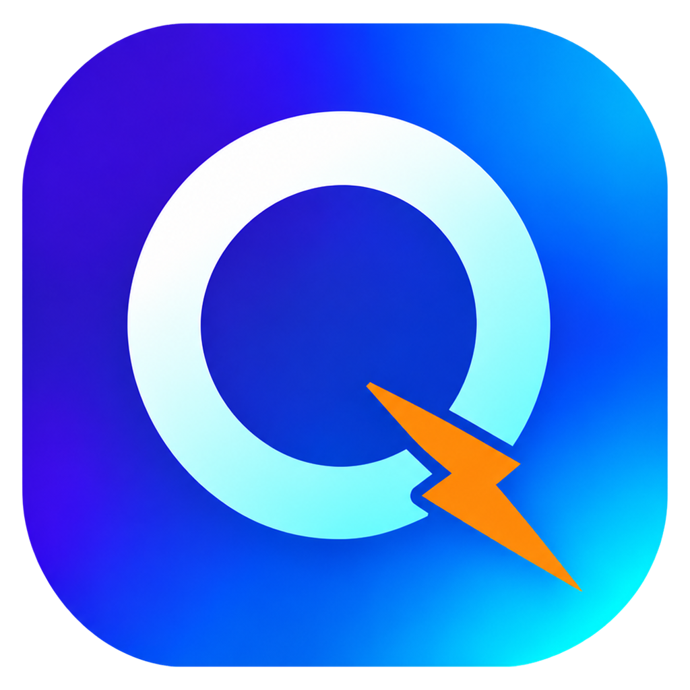

<div align="center">



# QRun

<p>English | <a href="README.zh-CN.md">简体中文</a></p>

<p><strong>A lightweight launcher for Windows, written in Rust with GPUI.</strong></p>

</div>

> QRun keeps the apps, files and folders you use every day in grouped tabs on one panel, and opens any of them
> with a click.

## ✨ Features

- **Grouped panel**: organize items into tabs; right-click a tab to rename it, delete it or sort it by click count.
- **Drag and drop**: drop files, folders or shortcuts onto the panel; their system icons are picked up automatically.
  A target already in the group is not added twice; items with the same name can be skipped too (a setting).
- **Click to launch**: files, folders, shortcuts and URLs open with their default handler.
- **Import from Rolan**: on the Data page of settings, bring in Rolan 2's groups and items in one click; groups with the
  same name are merged, existing targets are skipped, and click counts come along.
- **Recommended page** (can be turned off in settings): pinned before the groups, showing what you are likely to open next, your most used items, and the
  files, folders and programs Windows recently opened. Predictions use the local launch history (frequency, hour of
  day, weekday or weekend, what you usually open next) and the situation when the panel opens (foreground program and
  window title, what you just copied, running programs, recent activity). Each situation is split into tags (the
  start of the copied text, the foreground program, parts of the window title, what just happened), and QRun keeps a
  ledger of what you opened under each tag, so after copying SQL a few times it learns to put your database client
  first. The ledger and the weights are stored in `qrun.db` and keep accumulating; old habits fade with a 30-day
  half-life. Optionally, enter an API base URL and key in settings to let the Jev decision model weigh in: it sees
  your own habits for each candidate, sorts the top 20 and tags the situation (what you copied, what you are doing),
  and how much it counts depends on how well it has ranked what you actually opened.
  While recommendations are on, QRun keeps a local activity record (foreground window and title, programs starting and
  exiting, file changes in your user folder and on other local drives, the start of copied text, ports starting to
  listen). Recommended files and folders come only from what you opened (Windows recent items and each program's jump
  list); file changes just move those up, so logs, databases and caches written by programs are never recommended. It
  never reads file contents. **All of this stays on your computer and is never uploaded to any server or cloud.** The
  only exception is the Jev key: if you enter one yourself, a redacted summary is sent to Jev; without a key nothing
  leaves your computer. Copied text, window titles and search terms are redacted on this computer before they are
  stored or sent: keys, tokens, passwords, emails, phone, ID and bank card numbers are replaced with placeholders, and
  content from password managers is not read. The Privacy page of settings turns each kind of collection on or off,
  sets how many days the activity record is kept (60 by default; learned habits stay), and can clear the activity
  record or reset recommendations.
- **Search**: filter by name across all groups, ranked by what you are most likely to open now; press Enter to open the
  first match.
- **Item menu**: run as administrator, open with, open file location, copy path, copy file, edit (name, target,
  arguments, always run as administrator) and delete. Tiles on the recommended page have a menu too, and ones not in a
  group can be added to one.
- **Drag out**: drag a file from a group or the recommended page out of the panel and drop it into WeChat, File
  Explorer and so on (it is copied, never moved). Programs are dragged out as shortcuts by default (this can be changed
  in settings); shortcuts stay shortcuts. Dragging over a group tab switches to that group, also for files
  dragged in from outside.
- **Edge docking**: drag the panel to the top, left or right edge (or past it) to dock; it slides off-screen when the
  mouse leaves and slides back when the mouse touches that edge.
- **System tray**: the panel stays out of the taskbar; click the tray icon to show it, right-click for the menu.
- **Settings window**: open it from the gear button or the tray menu. Pages: General (start with Windows, single or
  double click to launch, switch groups on hover, always on top, hide after launch, skip duplicate names, drag programs out as shortcuts or files), Appearance (font, horizontal or vertical tabs, icon size, opacity), Recommended, Privacy, Docking, Data (data folder, import from Rolan) and About (version, updates).
- **Start with Windows**: registered under the current user's `Run` registry key, only when you turn it on.
- **Updates**: checks for new releases at startup and every 24 hours (GitHub first, then the
  [CNB mirror](https://cnb.cool/alsc1n/qrun) for users in China). The installed version downloads the installer,
  verifies its SHA-256 and updates itself; the portable version opens the download page.
- **Data location**: `settings.json`, `qrun.db` and the log live in `%LOCALAPPDATA%\QRun` by default, for both the
  installed and the portable version. Type a path or pick a folder on the Data page of settings to move them (for
  example next to the executable, to carry a portable copy around); the data is moved over and QRun restarts.

Planned: a global hotkey.

## 🛠 Build from source

Requires Windows 10/11 and the latest stable Rust (MSVC toolchain).

```sh
git clone https://github.com/alsc1n/qrun.git
cd qrun
cargo run            # development
cargo build --release
```

The release executable is `target/release/qrun.exe`.

## ⚙️ Configuration

`settings.json` and `qrun.db` are created in the data folder on first run (`%LOCALAPPDATA%\QRun` by default; the Data
page of settings opens and changes it). `settings.json` holds the preferences,
which are normally changed from the settings window:

| Field | Meaning |
| --- | --- |
| `general.launch_click` | `single` (launch items with a single click) or `double` (double click) |
| `general.hover_switch_group` | Switch groups by resting the mouse on a group tab |
| `general.always_on_top` | Keep the panel above other windows when not docked (it is always on top while docked) |
| `general.hide_after_launch` | Hide the panel after launching an item (not while docked) |
| `general.dedupe_names` | Skip an item being added when its group already has one with the same name (case-insensitive). Off by default: it is added under the same name for you to rename. An item whose target is already in the group is never added again |
| `general.drag_program` | `shortcut` (a program dragged out of the panel becomes a shortcut carrying the item's name and arguments) or `file` (the program itself); shortcuts are always dragged as they are |
| `appearance.tab_layout` | `horizontal` (tabs above the icons) or `vertical` (tabs on the left) |
| `appearance.font_family` | UI font family, `HarmonyOS Sans SC` by default (shipped in the `fonts` folder next to the executable). Empty means the system font, Segoe UI with Microsoft YaHei for Chinese; a font that is neither installed nor in `fonts` also falls back to it |
| `appearance.icon_size` / `appearance.opacity` | Icon display size, and panel background opacity from 0 to 1 |
| `smart.enabled` | Recommendations on or off. When off, the recommended page is hidden, Windows recent items are not read, no activity timeline is kept, nothing is learned, Jev is not called and search matches by name only; learned data is kept |
| `smart.predict` / `smart.frequent` / `smart.recent_files` / `smart.recent_folders` / `smart.recent_programs` | How many entries each recommended page section shows at most; 0 hides the section |
| `smart.jev_base_url` | Base URL of the Jev API, TypeSafe's official `https://api.typesafe.ai/v1` by default; requests go to `{base}/systemone` |
| `smart.jev_key` | API key for the Jev decision model; an empty URL or key turns Jev off. When set, the redacted situation (foreground program and window title, recent activity including the start of copied text), recent launches and the top candidates with your habits are sent to the base URL |
| `smart.collect.window` / `.clipboard` / `.processes` / `.files` / `.new_files` / `.system_recent` | What recommendations collect: foreground and open windows, the start of copied text (off: only its type), programs starting and exiting and listening ports, file changes, new files in Downloads and on the desktop, Windows recent items and jump lists (off: the recent sections of the recommended page are hidden). All on by default |
| `smart.ignore.dirs` / `smart.ignore.extensions` | Folders and file extensions never recommended (lowercase, extensions without the dot). A folder given by name (`temp`) excludes every folder with that name anywhere in a path; a full path (`D:\logs`) excludes only that folder. Defaults cover temp, cache, recycle bin and dependency folders, and temporary, backup, lock, partial download and crash dump files. Hidden and system files and Office lock files (`~$…`, `.~lock.…#`) are always excluded |
| `smart.retention_days` | How many days the activity record is kept, 60 by default; learned habits are kept regardless |
| `dock.enabled` | Whether edge docking is on |
| `dock.lock_position` | Lock the docked panel: it cannot be dragged away, and launching QRun again does not undock it |
| `dock.snap_distance` | How close to an edge (logical pixels) the panel must be dropped to dock |
| `dock.hide_delay_ms` / `dock.animation_ms` | Delay before a docked panel hides, and the slide duration |
| `window.width` / `window.height` | Panel size in logical pixels |

Start with Windows is not stored here; the registry is the single source of truth.

`settings.json` carries a top-level `version` for its structure. Missing settings fall back to their defaults, while
unknown field names are reported as errors. A file written by a newer QRun is left untouched and QRun asks you to
upgrade.

`qrun.db` is an SQLite database holding the groups, their items and the launch history, versioned through
`user_version` under the same rules. The launch history keeps accumulating and drives sorting by click count.
During the compatibility period the groups and items are also written to a `library.json` in the 0.1.0 format, so
downgrading keeps your data (0.1.0 reports that `settings.json` comes from a newer version; delete it to start);
if it was changed by an older QRun, it wins when you upgrade again.
If either file cannot be read, QRun shows the reason and exits instead of starting with broken data.

## 🤝 Contributing

Issues and pull requests are welcome. Before committing, make sure these pass:

```sh
cargo fmt --check
cargo clippy -- -D warnings
```

Commit messages follow [Conventional Commits](https://www.conventionalcommits.org/), e.g.
`feat(search): match pinyin initials`.

## 📄 License

[Apache License 2.0](LICENSE). Third-party notices are in [NOTICE](NOTICE).

## 🙏 Acknowledgements

- [GPUI](https://github.com/zed-industries/zed) and [GPUI Kit](https://github.com/longbridge/gpui-kit) for the UI
  framework and components.
- [Lucide](https://lucide.dev) for the interface icons.
- [HarmonyOS Sans](https://developer.huawei.com/consumer/cn/design/resource/) for the interface font, used under the
  HarmonyOS Sans Fonts License Agreement.
