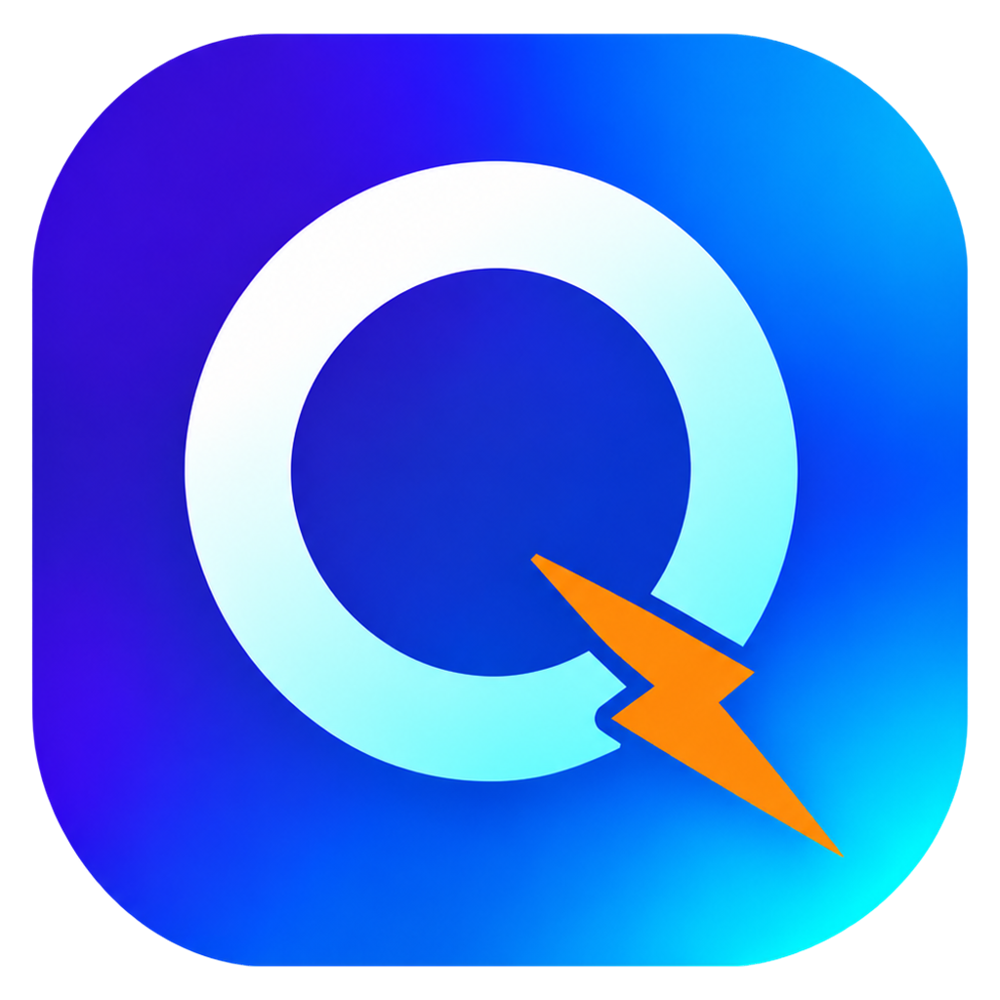

<div align="center">



# QRun

<p><a href="README.md">English</a> | 简体中文</p>

<p><strong>轻量的 Windows 快速启动器，用 Rust 和 GPUI 编写。</strong></p>

</div>

> QRun 把常用的应用、文件和文件夹按分组摆在一个面板里，点一下就打开。

## ✨ 功能

- **分组面板**：用标签页整理项目，右键分组可以重命名、删除，或改成按点击次数排序。
- **推荐页**：固定在分组最前面，显示猜你要打开、最常用、系统最近打开的文件、文件夹和程序。预测只用本机的启动记录，按常用度、钟点、工作日/周末、“开完 A 常接着开 B”，以及打开前在用的程序、窗口标题、剪贴板类型等情境打分，并从每次点了什么、跳过了什么里学权重，越用越准。可选在设置里填接口地址和密钥接入 Jev 决策模型一起判断。开着推荐时还会在本机记一条最近 2 小时的活动时间线（前台窗口和标题、程序启动退出、用户目录和其他本地硬盘上的文件改动、剪贴板类型、开始监听的端口），推荐里的文件和文件夹只来自你打开过的记录（系统最近记录和各程序的跳转列表），文件改动只让这些排得更靠前，程序自己写的日志、数据库、缓存不会进推荐。只记路径、名称和时间，不读文件和剪贴板内容，存在 `qrun.db` 里，超过 2 小时的自动丢掉。设置里可以整个关掉推荐。
- **拖拽添加**：把文件、文件夹或快捷方式拖进面板，自动读取系统图标。分组里已有的同一目标不会重复添加；也可以在设置里开启按名称去重。
- **点击启动**：用系统默认方式打开文件、文件夹、快捷方式和网址。
- **从 Rolan 导入**：设置的“数据”页一键导入 Rolan 2 的分组和项目，同名分组合并，已有的目标跳过，点击次数一并带过来。
- **搜索**：跨分组按名称过滤，结果按现在最可能打开的排序，回车打开第一个。
- **项目右键菜单**：以管理员身份运行、打开方式、打开所在位置、复制路径、复制文件、编辑（名称、目标、参数、始终以管理员权限启动）、删除。推荐页的格子也有右键菜单，不在分组里的可以添加到分组。
- **拖到别的程序**：把分组或推荐页里的文件拖出面板，可以直接放进微信、资源管理器等（复制，不会移动原文件）。程序默认拖出为快捷方式（可在设置里改），快捷方式拖出后仍是快捷方式。拖动时经过分组标签会切到该分组，从外面拖进来的文件也一样。
- **贴边悬停**：把面板拖到屏幕上、左、右边附近或拖出边外即可吸附；鼠标离开后滑出屏幕，鼠标碰到该边时滑回。
- **系统托盘**：面板不占任务栏，单击托盘图标打开，右键弹出菜单。
- **设置窗口**：从标题栏齿轮按钮或托盘菜单打开，分常规（开机自启、单击或双击启动、悬停切换分组、置于顶层、启动后收起、按名称去重、拖出程序）、外观（界面字体、标签横排/竖排、图标大小、不透明度）、推荐、贴边、数据（数据目录、从 Rolan 导入）、关于（版本、检查更新）六页。
- **开机自启**：写入当前用户注册表的 `Run` 项，只在你打开开关时写入。
- **自动更新**：启动时和之后每 24 小时检查新版本，先查 GitHub，查不到再用国内镜像 [CNB](https://cnb.cool/alsc1n/qrun)。安装版下载安装包、校验 SHA-256 后自动更新；绿色版打开下载页。
- **数据位置**：`settings.json`、`qrun.db` 和日志默认放在 `%LOCALAPPDATA%\QRun`（安装版和绿色版一样）。可在设置的“数据”页填路径或选择目录改到别处，比如想整个目录拷走的绿色版可以改到 exe 旁边；数据随之搬过去，QRun 自动重启。

规划中：全局热键呼出。

## 🛠 从源码构建

需要 Windows 10/11 和最新稳定版 Rust（MSVC 工具链）。

```sh
git clone https://github.com/alsc1n/qrun.git
cd qrun
cargo run            # 开发运行
cargo build --release
```

发布版 exe 在 `target/release/qrun.exe`。

## ⚙️ 配置

首次运行会在数据目录（默认 `%LOCALAPPDATA%\QRun`，设置“数据”页可以打开和更改）生成 `settings.json` 和 `qrun.db`。`settings.json` 是设置，一般在设置窗口里改：

| 字段 | 说明 |
| --- | --- |
| `general.launch_click` | `single`（单击启动项目）或 `double`（双击启动） |
| `general.hover_switch_group` | 鼠标停在分组标签上就切换分组 |
| `general.always_on_top` | 未贴边时面板也保持在最上层（贴边时总是置顶） |
| `general.hide_after_launch` | 启动项目后收起面板（贴边时不收） |
| `general.dedupe_names` | 添加项目时，分组里已有同名的（不区分大小写）就不加。默认关闭：同名照样加进去，名称不变，由你自己改。分组里已有同一目标的总是不重复添加 |
| `general.drag_program` | `shortcut`（程序拖出面板时生成快捷方式，带上项目的名称和参数）或 `file`（拖出程序本身）；快捷方式总是原样拖出 |
| `appearance.tab_layout` | `horizontal`（标签在图标上方）或 `vertical`（标签在左侧） |
| `appearance.font_family` | 界面字体的字体族名，默认 `HarmonyOS Sans SC`（随程序放在 exe 旁的 `fonts` 目录）；空表示系统默认（Segoe UI，中文用微软雅黑）；本机没装、`fonts` 里也没有的字体同样用系统默认 |
| `appearance.icon_size` / `appearance.opacity` | 图标显示尺寸，面板背景不透明度（0 到 1） |
| `smart.enabled` | 推荐开关；关掉后不显示推荐页，不读系统最近记录、不记活动时间线、不学习、不调 Jev，搜索只按名称，已学到的数据保留 |
| `smart.predict` / `smart.frequent` / `smart.recent_files` / `smart.recent_folders` / `smart.recent_programs` | 推荐页各块最多显示几个，0 表示不显示 |
| `smart.jev_base_url` | Jev 的接口地址，默认 TypeSafe 官方 `https://api.typesafe.ai/v1`，请求发到它后面加 `/systemone` |
| `smart.jev_key` | Jev 的 API 密钥；地址或密钥留空就不用 Jev，只用本地算法。填了会把前台程序和窗口标题、最近打开记录、候选列表发给接口地址 |
| `dock.enabled` | 是否启用贴边 |
| `dock.lock_position` | 锁定贴边位置：吸附后窗口拖不动，再次启动 QRun 也不解除吸附 |
| `dock.snap_distance` | 松手时离屏幕边多近（逻辑像素）就吸附 |
| `dock.hide_delay_ms` / `dock.animation_ms` | 吸附后鼠标离开多久缩回，以及滑动动画时长 |
| `window.width` / `window.height` | 面板大小（逻辑像素） |

开机自启不存在这里，以注册表为准。

`settings.json` 顶层有 `version`，记录文件结构的版本。缺少的设置项取默认值，写错的字段名会报错。文件来自更新版本的 QRun 时，原样不动并提示升级。

`qrun.db` 是 SQLite 库，存分组、项目和启动记录，版本记在 `user_version`，规则同上。启动记录一直累积，用来按点击次数排序。
兼容期内分组和项目还会同时写一份 0.1.0 结构的 `library.json`，装回旧版数据还在（0.1.0 会提示 `settings.json` 来自更新版本，删掉它即可启动）；在旧版里改过再升级回来时，以 `library.json` 为准。
任一文件读不了时，QRun 会弹窗说明原因并退出，不会带着坏数据启动。

## 🤝 参与贡献

欢迎提 Issue 和 PR。提交前请确认：

```sh
cargo fmt --check
cargo clippy -- -D warnings
```

提交信息使用 [Conventional Commits](https://www.conventionalcommits.org/)，例如 `feat(search): match pinyin initials`。

## 📄 许可证

[Apache License 2.0](LICENSE)。第三方声明见 [NOTICE](NOTICE)。

## 🙏 致谢

- [GPUI](https://github.com/zed-industries/zed) 和 [GPUI Kit](https://github.com/longbridge/gpui-kit)：界面框架与组件。
- [Lucide](https://lucide.dev)：界面图标。
- [HarmonyOS Sans](https://developer.huawei.com/consumer/cn/design/resource/)：界面字体，按 HarmonyOS Sans 字体许可协议使用。
